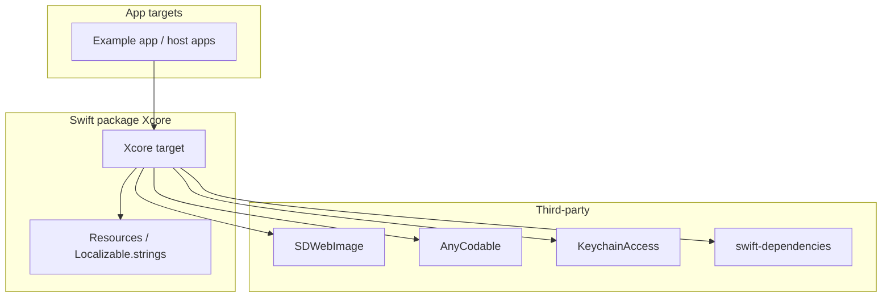

# Xcore architecture map

## Packaging

## Source layout (logical, not SPM targets)

| Layer | Directory | Depends on | Notes |
| --- | --- | --- | --- |
| Foundation helpers | `Swift/Extensions`, `Swift/Helpers`, `Swift/Protocols` | Foundation, re-exported deps | Includes `Collection.uniqued`, `Xcore.swift` exports |
| Components | `Swift/Components/*` | Helpers | Domain-oriented: Analytics, AppError, Cache, FeatureFlag, … |
| DI clients | `Swift/Dependencies/*` | Components + Cocoa/SwiftUI as needed | `@Dependency` keys; prefer struct + variants |
| UIKit | `Cocoa/*` | Swift components | Image pipeline, HUD |
| SwiftUI | `SwiftUI/*` | Swift + Cocoa | Views bind to same components/clients |

**Dependency direction:** SwiftUI → Cocoa/UIKit → Swift components → Helpers. No target-level enforcement today; convention only.

## State ownership

| Concern | Owner | Location |
| --- | --- | --- |
| Feature flag provider stack | `FeatureFlag.provider` (static composite) | `FeatureFlag+Providers.swift` |
| Analytics provider list | `Analytics.providers` (instance) | `Analytics.swift` |
| Image fetcher registration | `UIImage` namespace / composite | `ImageFetcher/*` |
| Dependency defaults | `DependencyKey` live/test/preview | `*/Dependencies/*` |
| Localized copy | Generated `LocalizableStrings` | SwiftGen + `Resources/` |

## Duplicate / parallel implementations

| Semantics | Implementations | Verdict |
| --- | --- | --- |
| Unique elements by key | `Collection.uniqued`, `uniqued(_:)` | **Canonical** — single helper |
| Composite provider registration | Analytics, FeatureFlagProvider, ImageFetcher | **Parallel by design** — different protocols |
| Address search | Protocol `AddressSearchClient` + Live/Noop/Unimplemented types | **Divergent** — see P-001 |
| Top view controller | `UIApplication.topViewController` + `UIWindow.topViewController` | **Layered** — window delegates to application helper |

## Verification entrypoints

| Command | Purpose |
| --- | --- |
| `make build` | Compile Example + Xcore |
| `make test` | Full test suite |
| `make lint` | SwiftLint |
| `make audit-architecture` | Dependency key & governance scripts (no Xcode) |