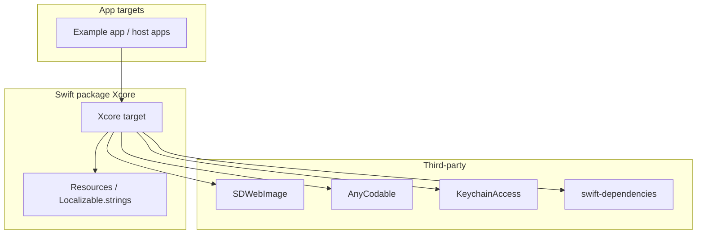

# Xcore architecture map

## Packaging

## Source layout (logical, not SPM targets)

| Layer | Directory | Depends on | Notes |
| --- | --- | --- | --- |
| Foundation helpers | `Swift/Extensions`, `Swift/Helpers`, `Swift/Protocols`, `Swift/PropertyWrappers` | Foundation, re-exported deps | [EXTENSIONS_INDEX.md](./EXTENSIONS_INDEX.md), [HELPERS_INDEX.md](./HELPERS_INDEX.md), [SWIFT_PROTOCOLS_INDEX.md](./SWIFT_PROTOCOLS_INDEX.md), [SWIFT_PROPERTY_WRAPPERS_INDEX.md](./SWIFT_PROPERTY_WRAPPERS_INDEX.md) |
| Components | `Swift/Components/*` | Helpers | [COMPONENT_INDEX.md](./COMPONENT_INDEX.md) |
| DI clients | `Swift/Dependencies/*` | Components + Cocoa/SwiftUI as needed | [DEPENDENCY_REGISTRY.md](./DEPENDENCY_REGISTRY.md), [DEPENDENCY_LAYOUT.md](./DEPENDENCY_LAYOUT.md) |
| UIKit | `Cocoa/*` | Swift components | [COCOA_COMPONENT_INDEX.md](./COCOA_COMPONENT_INDEX.md), [COCOA_EXTENSIONS_INDEX.md](./COCOA_EXTENSIONS_INDEX.md), [COCOA_SUPPORTING_INDEX.md](./COCOA_SUPPORTING_INDEX.md) |
| SwiftUI | `SwiftUI/*` | Swift + Cocoa | [SWIFTUI_COMPONENT_INDEX.md](./SWIFTUI_COMPONENT_INDEX.md), [SWIFTUI_EXTENSIONS_INDEX.md](./SWIFTUI_EXTENSIONS_INDEX.md) |

**Dependency direction:** SwiftUI → Cocoa/UIKit → Swift components → Helpers. Cocoa→SwiftUI import allowlist: [LAYER_IMPORTS.md](./LAYER_IMPORTS.md).

### Module boundary conventions (T-013 baseline)

| Belongs in | Examples | Avoid |
| --- | --- | --- |
| `Swift/Dependencies/` | `OpenURLClient`, `AppPhaseClient`, service structs | Heavy SwiftUI view code |
| `Swift/Components/` | `FeatureFlag`, `Analytics`, `Cache` | Direct `UIApplication` calls without Cocoa layer |
| `SwiftUI/Components/` | `Pond`, `DataStatusView` | Business rules duplicated from `Swift/Components` |
| `Cocoa/Components/` | `ImageFetcher`, `HUD` | SwiftUI-only types |

`Pond` remains under SwiftUI because storage keys tie to SwiftUI previews and environment; dependency key is still audited like other clients.

## State ownership

| Concern | Owner | Location |
| --- | --- | --- |
| Feature flag provider stack | `FeatureFlag.provider` (static composite) | `FeatureFlag+Providers.swift` |
| Analytics provider list | `Analytics.providers` (instance) | `Analytics.swift` |
| Image fetcher registration | `UIImage` namespace / composite | `ImageFetcher/*` |
| Dependency defaults | `DependencyKey` live/test/preview | `*/Dependencies/*` |
| Localized copy | Generated `LocalizableStrings` | SwiftGen + `Resources/` |
| Typed metadata bags | `UserInfoContainer` | `UserInfoKey.swift` (ADR 0005) |
| Layout / theme defaults | `Theme.default` (`cornerRadius`); `AppConstants` forwards + spacing | `Theme.swift`, `Constants.swift` (ADR 0005; `audit_layout_ssot.sh`) |

## Duplicate / parallel implementations

| Semantics | Implementations | Verdict |
| --- | --- | --- |
| Unique elements by key | `Collection.uniqued`, `uniqued(_:)` | **Canonical** — single helper |
| Composite provider registration | Analytics, FeatureFlagProvider, ImageFetcher | **Parallel by design** — different protocols |
| Address search | Struct `AddressSearchClient` + `LiveAddressSearchClient` engine | **Canonical** (T-107) |
| Top view controller | `UIApplication.topViewController` + `UIWindow.topViewController` | **Layered** — window delegates to application helper |

## Verification entrypoints

| Command | Purpose |
| --- | --- |
| `make build` | Compile Example + Xcore |
| `make test` | Full test suite |
| `make lint` | SwiftLint |
| `make audit-architecture` | Governance audits — [AUDIT_INDEX.md](./AUDIT_INDEX.md), [GOVERNANCE_METRICS.md](./GOVERNANCE_METRICS.md) (no Xcode) |